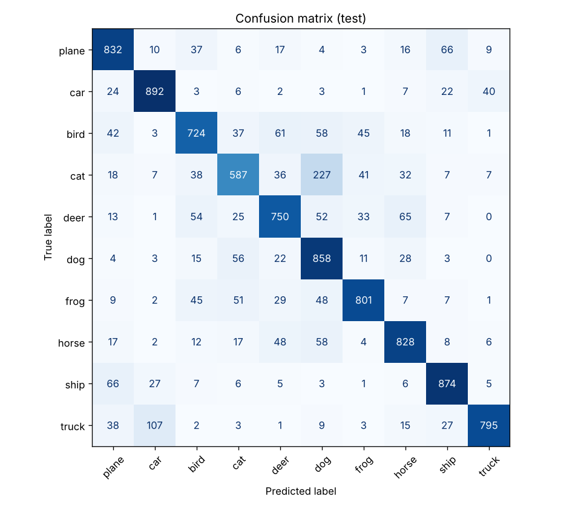
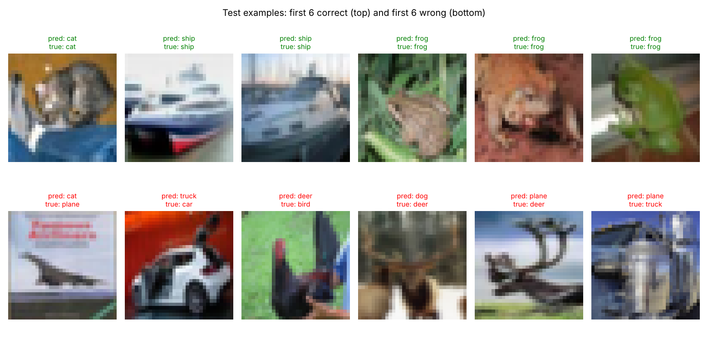

# CIFAR-10 image classification: transfer learning with ResNet-18

Image classifier for the 10 CIFAR-10 classes built on an ImageNet-pretrained **ResNet-18**.
The backbone is frozen and only a new 10-class head is trained (5,130 trainable parameters).

**Test accuracy: 79.41 %** on the 10,000 official test images (re-computed from the saved weights, see `results/metrics.json`).

## Results

| Class | Acc. % | | Class | Acc. % |
|---|---|---|---|---|
| plane | 83.2 | | dog | 85.8 |
| car | 89.2 | | frog | 80.1 |
| bird | 72.4 | | horse | 82.8 |
| cat | **58.7** | | ship | 87.4 |
| deer | 75.0 | | truck | 79.5 |



The weakest class is **cat** (58.7 %): 227 of 1000 cats are predicted as dogs. The second biggest confusion is
truck → car (107). Both are visually similar pairs, so errors are concentrated where a human would also hesitate.



## Method

- **Data:** CIFAR-10, 50,000 train images split 80/20 into train/validation (fixed seed), 10,000 test images.
- **Preprocessing:** images are upscaled 32 → 224 px to match the ImageNet input size of ResNet; pixels normalised to [-1, 1].
- **Augmentation (train only):** random horizontal flip, random crop with 4 px padding.
- **Model:** `torchvision` ResNet-18 (ImageNet weights), all layers frozen, `fc` replaced by `Linear(512, 10)`.
- **Training:** Adam, lr = 1e-3, batch size 64, 10 epochs, cross-entropy loss.

## Run it

```bash
pip install -r requirements.txt

# train (a GPU is strongly recommended: images are 224x224)
python src/train.py --epochs 10 --out resnet_model.pth

# evaluate saved weights on the test set
python src/evaluate.py --weights resnet_model.pth
```

CIFAR-10 is downloaded automatically into `data/`. Trained weights (45 MB) are attached to the
[Releases](../../releases) page; download `resnet_model.pth` and put it in the repo root to skip training.
`evaluate.py` writes `metrics.json`, the confusion matrix and a grid of examples to `results/`.

## Notes and limitations

- The released weights come from my original training run. The training code in this repo is the cleaned-up
  version of that run; the one functional fix is that augmentation is no longer applied to the validation split.
  Training was **not** re-run for this repository, so accuracy numbers refer to the released weights.
- Only the classification head is trained, so accuracy is limited by features learned on ImageNet.
- Ideas to improve: unfreeze `layer4` and fine-tune with a lower learning rate, switch to ImageNet mean/std
  normalisation, keep BatchNorm in eval mode while the backbone is frozen, add a learning-rate schedule.

## Project layout

```
src/data.py       data loading, augmentation, train/val/test split
src/model.py      ResNet-18 with a new head
src/train.py      training loop, saves weights and learning curves
src/evaluate.py   test accuracy, per-class accuracy, confusion matrix, examples
results/          metrics.json, confusion_matrix.png, sample_predictions.png
tests/            quick sanity test of the model
```
